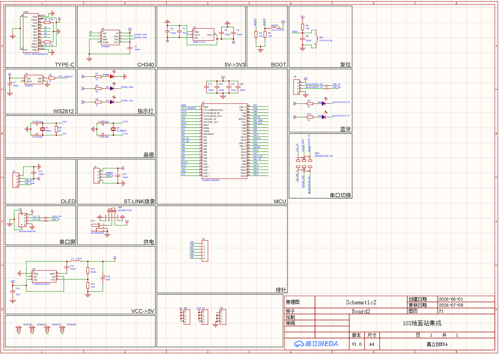
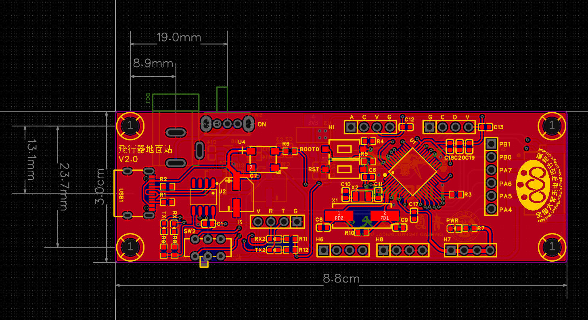
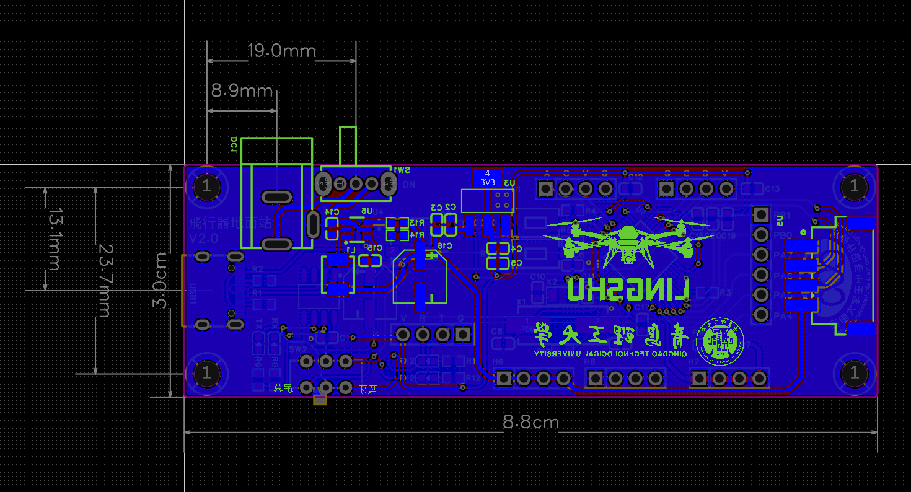
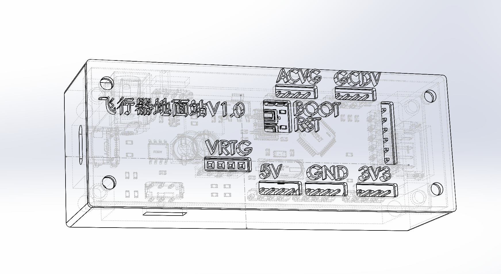
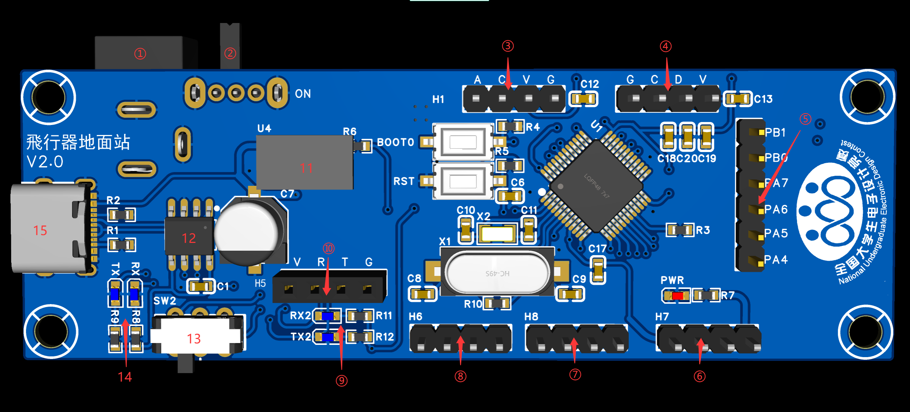
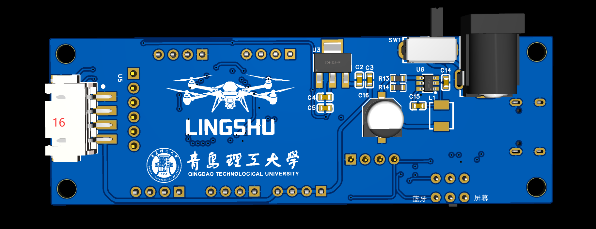

# ground-station

贺梓健自研地面站的软硬件相关资料

## 项目概述

本项目是一款面向大学生电子设计竞赛飞行器题目的飞行器地面站，配套飞行器端控制系统使用，主要用于提供稳定供电、串口与蓝牙通信、数据收发及运行状态指示等功能，便于赛前调试、飞行过程中的数据交互和系统状态监测。项目包含地面站的硬件设计、PCB布局及结构外壳等相关资料。

## 图片资料

### 原理图：

### layout：

### 3D外壳：

## 功能介绍：

1. **12V-DC电源输入**：预留DC接口，使用12V锂电池为单片机和串口屏供电。
2. **电池供电开关**：打向LOGO端为开。
3. **OLED预留引脚**：预留4P-OLED屏幕接口，连接引脚为**PB7-SDA、PB6-SCL**。
4. **烧录引脚**：支持ST-Link等烧录器。
5. **GPIO预留引脚**：预留GPIO引脚，可连接电机驱动等。
6. **3.3V供电引脚**：输出3.3V左右电压。
7. **GND引脚**
8. **5V供电引脚**：输出5V左右电压。
9. **蓝牙数据收发指示灯**：当蓝牙串口收发数据时，指示灯会闪烁，可直观查看数据收发情况，连接引脚为**PA2-TX、PA3-RX**。
10. **蓝牙预留引脚**：连接蓝牙，进行空地通信。
11. **WS2812RGB彩灯**：连接引脚为**PC13**，作为指示灯使用。
12. **CH340**：搭载USB-TTL芯片，可通过TypeC数据线连接电脑便捷调试串口屏及蓝牙串口。
13. **串口切换开关**：控制TypeC连接的蓝牙通道，可热切换调试串口。
14. **串口屏数据收发指示灯**：当串口屏串口收发数据时，指示灯会闪烁，可直观查看数据收发情况，连接引脚为**PA9-TX、PA10-RX**。
15. **TypeC**：可通过数据线连接电脑串口调试工具，直接调试串口屏和蓝牙串口。
16. **串口屏接口**：直接通过XH2.54-4P接口连接串口屏。
